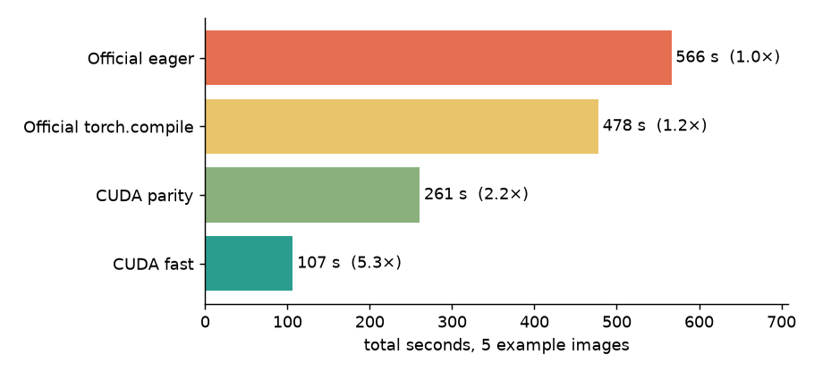
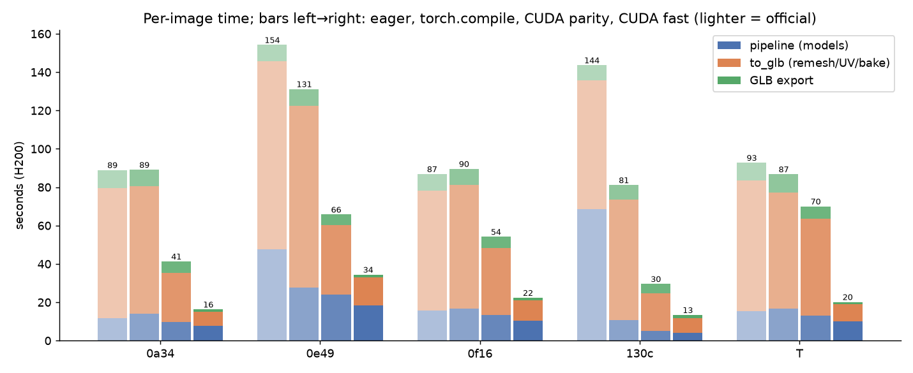
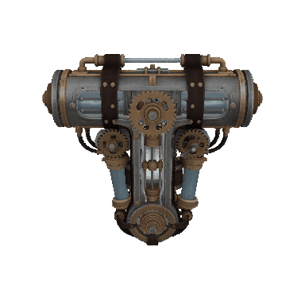

# TRELLIS.2 in CUDA C++

Image → textured GLB for [TRELLIS.2-4B](https://github.com/microsoft/TRELLIS.2) (`1024_cascade`, `example.py` `to_glb` settings),
with no Python at runtime. Two builds from one binary:

- **parity** (default): bitwise identical to the official PyTorch pipeline from the input image to the final mesh and attributes,
  and through the GLB writer (texture bake, TELEA inpaint, WebP, glTF bytes). The one exception is the vertex-normal buffer:
  CuMesh accumulates normals with atomics, so the official code is nondeterministic there too.
- **fast** (`T2_FAST=1`): tolerance-bounded; see below.

The full worklog (method, bugs, figures) is in [docs/blog.md](docs/blog.md).

## Results (H200, 5 example images, warm process, 1 warmup, seconds)

Second benchmark session, after the end-to-end optimizations of the fast build (all six columns measured in one H200 job;
the first session's table is kept below):

| Image | Official eager | Official eager, warm autotune | Official torch.compile | CUDA parity | CUDA fast (before) | CUDA fast |
|---|---|---|---|---|---|---|
| 0a34 | 84.7 | 79.4 | 90.6 | 46.8 | 16.5 | **9.6** |
| 0e49 | 160.5 | 136.0 | 124.8 | 60.5 | 34.3 | **19.3** |
| 0f16 | 88.8 | 119.5 | 97.7 | 50.0 | 22.0 | **13.4** |
| 130c | 131.8 | 74.2 | 77.3 | 27.3 | 13.0 | **6.7** |
| T.png | 92.6 | 102.9 | 82.3 | 58.2 | 20.3 | **12.4** |
| **Sum** | 558.4 | 512.0 | 472.7 | 242.9 (2.3×) | 106.1 (5.3×) | **61.4 (9.1×)** |
| pipeline / `to_glb` / export | 176.5 / 338.6 / 43.2 | 76.4 / 395.1 / 40.6 | 87.3 / 343.2 / 42.2 | 65.4 / 149.4 / 28.2 | 50.4 / 48.4 / 7.3 | 43.4 / 15.2 / 2.8 |

"Official eager" starts from an empty FlexGEMM autotune cache, as in the first session; its `pipeline` time includes Triton
autotuning on first-seen sparse-conv shapes (0e49, 130c). "Warm autotune" is the same run repeated with the cache it
left behind, and torch.compile also ran with that cache. Against warm eager the fast build is 8.3×. The official `to_glb`
time varies by tens of seconds between runs of the same image (xatlas), which is why warm eager is slower than cold
eager on 0f16 and T.png. "CUDA fast (before)" is the previous fast build (git `4b7c7cd`) built and run in the same job.
Raw numbers: `bench/{eager_v2,eager_warm_v2,compile_v2,cuda_v2,fast_old,fast_v2}.json`; plots `docs/speedup_v2.png`, `docs/timing_v2.png`.

Per-stage sums over the 5 images for the new fast build (`stages` in `bench/fast_v2.json`):

| cond | sparse_structure | shape_slat | tex_slat | decode | remesh | simplify | uv_unwrap | bake | textures | export |
|---|---|---|---|---|---|---|---|---|---|---|
| 0.90 | 2.94 | 23.00 | 11.39 | 5.17 | 0.75 | 1.69 | 11.16 | 0.80 | 0.79 | 2.83 |

### First session


| Image | Official eager | Official torch.compile | CUDA parity | CUDA fast |
|---|---|---|---|---|
| 0a34 | 89.0 | 89.1 | 41.3 | **16.3** |
| 0e49 | 154.2 | 131.2 | 65.8 | **34.4** |
| 0f16 | 86.9 | 89.6 | 54.2 | **22.4** |
| 130c | 143.6 | 81.1 | 29.6 | **13.4** |
| T.png | 92.8 | 86.8 | 70.0 | **20.2** |
| **Sum** | 566.5 | 477.8 | 260.9 (2.2×) | **106.6 (5.3×)** |

Times are pipeline + `to_glb` + export, with model loading excluded. Raw numbers are in `bench/*.json`. Speedups are relative to eager.





Most of the official time is in `to_glb`: a serial CPU cuBVH build, quadratic xatlas chart growth, and single-threaded TELEA.
The large eager `pipeline` times on 0e49 and 130c are FlexGEMM's Triton autotuning on first-seen sparse-conv shapes.
The torch.compile run came afterwards and reused that saved cache (`~/.flex_gemm/autotune_cache.json`). The CUDA build
has no per-shape tuning step.

## Outputs

Rendered with nvdiffrast from the exported GLBs (base color with simple shading, same camera; `tools/render_glb.py`):


Turntable of the CUDA fast output for `T.png`:



## Fast build

| Change | Effect (T.png) |
|---|---|
| GPU LBVH (Morton + radix sort + Karras tree) instead of cuBVH's CPU build | 7.1 s → 5 ms, remesh still bitwise |
| Split CuMesh charts > 1024 faces before xatlas (its chart growth is quadratic and serial per mesh) | ComputeCharts 36 s → 1.3 s, ~1% more charts |
| GPU wavefront TELEA (per distance level, all 6 channels) | 8.2 s → 0.15 s |
| FlashAttention-3 (hopper, bf16 hdim128) for all DiT attention | shape 7.7 → 5.6 s, tex 3.7 → 2.6 s |
| WebP method 0 | export 6.0 → 1.4 s |

End-to-end optimizations added in the second session (sums over the 5 images, previous fast build → now):

| Change | Effect |
|---|---|
| Grouped parallel xatlas (`src/uv_atlas.cpp`): pieces dealt into 64 area-balanced groups, one Atlas per group on native threads with a shared texel scale, results shelf-tiled; thread pool sized from the cgroup CPU quota | uv_unwrap 32.6 → 11.2 s (the "before" stage numbers are from a `T2_PROF=1` run of the previous build earlier in the same job) |
| CuMesh pooled device allocator (`third_party/shim/cm_alloc.h`) and device-side `Buffer::fill`; no arithmetic change, so both builds use it | simplify 12.2 → 1.7 s, remesh 1.4 → 0.75 s |
| DiT: fused LayerNorm+modulate, QK-RMSNorm+RoPE+pack and gated-residual+LayerNorm kernels (`T2_DIT_FUSE`, default 1), GELU in the cuBLASLt GEMM epilogue (`T2_DIT_GELU_EPI`, default 1) | pipeline 50.4 → 43.4 s |
| Export: GPU texture packing, base-color WebP alpha plane at quality 0 (`T2_WEBP_ALPHA_Q`; the material is opaque) | export 7.3 → 2.8 s, bake+textures 2.0 → 1.6 s |

Tried and not kept: batching CFG cond/uncond into one forward (FA3 and the GEMMs already run at ~600 TFLOP/s for the
token counts where the DiT time is, so the bound is under 1 s over the 5 images); rewriting the sparse decoders (72% of
their time is the spconv kernel itself); jemalloc/tcmalloc and group-count or thread-count sweeps for xatlas (it is
CPU-bound in ComputeCharts on the 23-vCPU quota); a smaller chart split (`T2_XA_SPLIT=512` saves up to 30% of the
xatlas time on one image for ~1% more charts, 256/128 more for 9-30% more charts; kept at 1024).

Profiling knobs: `T2_PROF=1` (stages and sub-stages), `T2_DITPROF=1` (per-op DiT time), `T2_DECPROF=1` (per-level decoder time).

These also help parity mode without changing its output: xatlas sized to the cgroup CPU quota (`third_party/shim/xa_hw.h`).

**Tolerance gates.**
1. DiT sampling error (teacher-forced, `parity sample`) matches the official pipeline's own error when its attention
   backend is switched from flash_attn to xformers. Sparse-structure stage: mean abs 0.0145 / max 1.35 for both, and both
   give 3534 tokens.
2. End-to-end GLB vs official eager (`tools/compare_glb.py`: symmetric Chamfer distance over the bbox diagonal, and
   base-color L1 at matched surface samples). The fast build falls in the band of official torch.compile vs eager:

| Image | compile vs eager (Chamfer / color) | parity vs eager | fast vs eager |
|---|---|---|---|
| 0a34 | 2.4e-3 / 16.2 | 1.3e-3 / 3.3 | 2.4e-3 / 20.5 |
| 0e49 | 4.0e-3 / 23.3 | 1.7e-3 / 7.9 | 3.8e-3 / 23.6 |
| 0f16 | 2.9e-3 / 26.9 | 1.7e-3 / 5.6 | 3.0e-3 / 24.1 |
| 130c | 4.5e-3 / 25.8 | 0.9e-3 / 4.0 | 4.6e-3 / 26.6 |
| T.png | 3.0e-3 / 25.2 | 1.6e-3 / 6.1 | 2.8e-3 / 28.7 |

(Parity vs eager is nonzero only because CuMesh simplify is nondeterministic run to run.)

Second session, same check against the warm-cache eager GLBs (`bench/compare_v2.txt`). "eager vs eager" is the cold-cache
eager run against the warm-cache one, i.e. the official pipeline's own run-to-run spread:

| Image | eager vs eager | compile vs eager | parity vs eager | fast (before) vs eager | fast vs eager |
|---|---|---|---|---|---|
| 0a34 | 1.0e-3 / 3.1 | 2.2e-3 / 18.5 | 1.0e-3 / 3.1 | 2.2e-3 / 20.5 | 2.1e-3 / 19.5 |
| 0e49 | 1.4e-3 / 7.1 | 4.0e-3 / 23.3 | 1.4e-3 / 7.1 | 3.6e-3 / 23.6 | 3.6e-3 / 26.4 |
| 0f16 | 1.4e-3 / 4.8 | 2.8e-3 / 23.7 | 1.4e-3 / 4.8 | 2.7e-3 / 24.2 | 2.7e-3 / 27.3 |
| 130c | 0.7e-3 / 3.6 | 4.4e-3 / 24.1 | 0.7e-3 / 3.6 | 4.5e-3 / 26.6 | 4.4e-3 / 25.4 |
| T.png | 1.3e-3 / 5.3 | 2.5e-3 / 27.5 | 1.3e-3 / 5.3 | 2.5e-3 / 28.7 | 2.6e-3 / 26.8 |

Chamfer is at or below compile-vs-eager on three images, 1% above it on 130c and 8% above it on T.png. Color L1 is inside the compile-vs-eager
range over the set (18.5-27.5) but above the same image's compile number on 0e49 (+3.1) and 0f16 (+3.6), and below it on
T.png. The color differences come from the DiT changes (a different but equally valid sample), not from the atlas or WebP
changes: with `T2_DIT_FUSE=0 T2_DIT_GELU_EPI=0` the new build gives 23.6 and 24.2 on those two images, the same as the
previous fast build, with or without the grouped atlas (`bench/compare_ab_v2.txt`). Teacher-forced sampling error
(`parity sample`, mean abs / max abs for the sparse-structure stage): 0e49 0.0190 / 1.64 before, 0.0179 / 0.92 now;
0a34 0.0166 / 0.88 before, 0.0170 / 1.50 now. Parity: all 15 checks of `tools/repro_parity.sh` pass on the final tree.

## Cost

HF Jobs compute, from job running time × listed price:

| Job | Flavor | Price | Running | Cost |
|---|---|---|---|---|
| `6ac54e95…` (all builds, parity runs, benchmarks) | h200 (1× H200, 23 vCPU) | $5.00/h | 8.4 h | ~$42 |
| `6ac55477…` (CPU box started while the H200 was queued 43 min) | cpu-performance | $1.90/h | 8.7 h | ~$17 |
| `6ac5e12c…` + `6ac5e099…` (fresh-container parity reproduction) | h200 | $5.00/h | 58 min | ~$5 |
| **Total** | | | | **~$64** |

Second session (end-to-end optimizations): `6b04ae01…` h200, 3.9 h, ~$19; `6b04c7df…` rtx-pro-6000 ($2.75/h, sm_120 TELEA
reproduction and fix check), 0.5 h, ~$1.4.

The benchmarks themselves are a small part of this. One full 4-way pass over the 5 images is about 24 GPU-minutes (~$2).
Most of the cost is development time on an idle-billing `sleep infinity` job.

Cursor model/API usage is not included. It is not visible from inside the agent; see the Cursor dashboard
([cursor.com/dashboard](https://cursor.com/dashboard) → Usage) for this session.

## Build and run

Requires CUDA 12.4+, cuDNN 9, CMake ≥ 3.24, Ninja, and an sm_90 GPU (FA3 is sm_90a).

```bash
tools/setup_ref.sh                         # official PyTorch reference (parity checks and baselines only)
tools/build.sh build                       # fetches pinned third-party sources, builds build/t2 and build/parity
tools/repro_parity.sh build                # official dumps + bitwise checks on the 5 example images
./build/t2 image.png out.glb [seed]        # parity build
T2_FAST=1 ./build/t2 image.png out.glb     # fast build
./build/t2 --bench out.json out_dir img... # timing as in tools/bench_ref.py
```

Checkpoints are read from `$T2_CKPT` (default `/workspace/ckpts`), as safetensors from `microsoft/TRELLIS.2-4B` and DINOv3.
Set `T2_PROF=1` for per-stage timing.

**Parity reproducibility.** FlexGEMM autotunes sparse-conv tiles by timing them, so its choices (and hence the fp32
accumulation order) can differ between machines. `assets/flexgemm_autotune.json` holds the H200 choices for the five
example images. The CUDA build reads it by default (`$T2_FLEXGEMM_CACHE` overrides), and `tools/repro_parity.sh` points
the official pipeline at the same file through `FLEX_GEMM_AUTOTUNE_CACHE_PATH`. On a fresh H200 container, that script
passes all 15 checks: 5 images × `pipe`, `glb` and `bake`. `pipe` and `glb` are bitwise; `bake` is identical except
the vertex normals. A new image or GPU needs one official run first, to add its tiles to the cache.

## Layout

- `src/`: models (DINOv3, flow DiTs, sparse-structure, shape and texture decoders), GEMM/attention/sparse-conv ops, the
  `to_glb` port (`glb.cu`), OpenCV TELEA (`inpaint.cpp`), and the trimesh/PIL GLB writer (`gltf.cpp`).
- `apps/parity.cu`: per-stage bitwise checks against dumps from `tools/ref_dump.py`.
- `tools/`: offline-only Python (reference dumps, official timing, GLB comparison, plots, and renders).
- `bench/`: raw timings, plus the T.png chart-size and TELEA-level dumps. `docs/`: blog, plots and renders.
- `assets/flexgemm_autotune.json`: the sparse-conv tile choices shared by both sides for bitwise parity.
- `hub/trellis2-kernels/`: a standalone [Kernel Hub](https://huggingface.co/docs/kernels) package (Apache-2.0) with
  two of the kernels written here: `mesh_udf` (GPU linear BVH, point-to-mesh distance, face id and barycentrics) and
  `telea_inpaint` (the fast build's wavefront TELEA, a GPU alternative to `cv2.inpaint`). It builds with
  `kernel-builder build-and-copy` for torch 2.13/2.14 × CUDA 12.6/13.0/13.2 and passes its tests on H200.
- `apps/t2lib.cu`, `space/`: the [ZeroGPU Space](https://huggingface.co/spaces/suvadityamuk/trellis2-cuda), which
  runs each image through the port and then through the official PyTorch code on the same GPU slice and shows both
  GLBs and their stage timings side by side (on half an RTX PRO 6000, 1M faces / 4096²: 51 s vs 118 s for T.png,
  82 s vs 157 s for 0e49). `libt2.so` is the pipeline as a C ABI (`t2_load`, `t2_image_to_glb`, `t2_last_error`)
  that `space/t2_run.py` loads with ctypes in a subprocess of the `@spaces.GPU` worker. Build it for the
  Blackwell GPUs behind ZeroGPU with `T2_CMAKE_ARGS=-DT2_CUDA_ARCH=120 tools/build.sh build120` (CUDA 12.8; FA2
  replaces the Hopper-only FA3), then `tools/make_space.sh build120 <TRELLIS.2 checkout>`. On an RTX PRO 6000 the
  fast build with `T2_TELEA_GPU=0` (the GPU TELEA faults on sm_120) takes 23-52 s per image at 4096² / 1M faces and
  stays within the torch.compile-vs-eager spread of the exact build.
  The sm_120 fault was a ptxas 12.8 miscompile of the TELEA fill kernel at `-O1` and above when its indices are 64-bit
  (sm_90/sm_100 targets and `-Xptxas -O0` are fine). The kernel now uses 32-bit indices with clamped loads, gives the
  same bytes on sm_90, and runs on an RTX PRO 6000 (T.png: 74 ms vs 6.5 s for the CPU inpaint). The Space runs a
  build of this tree with the GPU TELEA on: 10-45 s per example on a full RTX PRO 6000 at 4096² / 1M faces.

Third-party CUDA code is reused unmodified: flash-attention 2.7.3 (FA2 + FA3), CuMesh, cuBVH, xatlas, FlexGEMM,
nvdiffrast 0.4.0, cudnn-frontend, cutlass, and libwebp 1.4.0.

## Related

Part of [TRELLIS.2 everywhere](https://huggingface.co/collections/hugging-3d/trellis2-everywhere-6b062cf7d5ae3eca49def35b), built on Microsoft's [TRELLIS.2](https://huggingface.co/microsoft/TRELLIS.2-4B) ([paper](https://huggingface.co/papers/2512.14692)).

| | Hugging Face | GitHub |
|---|---|---|
| Fine-tuning (LoRA) | [footwear LoRA](https://huggingface.co/suvadityamuk/trellis-2-finetune-gso) · [trainer Space](https://huggingface.co/spaces/hugging-3d/3d-model-lora-trainer) · [subset builder](https://huggingface.co/spaces/hugging-3d/data-finetuning-subset-builder) | [trellis2-finetuning](https://github.com/suvadityamuk/trellis2-finetuning) |
| Data | [GSO footwear](https://huggingface.co/datasets/suvadityamuk/gso-footwear-trellis2-latents) · [GSO](https://huggingface.co/datasets/hugging-3d/gso-trellis2-latents) · [Smithsonian](https://huggingface.co/datasets/hugging-3d/smithsonian-trellis2-latents) · [NASA](https://huggingface.co/datasets/hugging-3d/nasa-trellis2-latents) latents | |
| Diffusers port | [TRELLIS.2-4B-diffusers-3d](https://huggingface.co/suvadityamuk/TRELLIS.2-4B-diffusers-3d) | [diffusers-3d](https://github.com/suvadityamuk/diffusers-3d) |
| NVIDIA (CUDA C++) | [kernels](https://huggingface.co/kernels/suvadityamuk/trellis2-cuda) · [Space](https://huggingface.co/spaces/suvadityamuk/trellis2-cuda) | [trellis2-cuda](https://github.com/suvadityamuk/trellis2-cuda) |
| Apple Silicon (Metal) | [kernels](https://huggingface.co/kernels/suvadityamuk/trellis2-metal) | [trellis2-metal](https://github.com/suvadityamuk/trellis2-metal) |
| AMD (ROCm/HIP) | [kernels](https://huggingface.co/kernels/suvadityamuk/trellis2-rocm) | [trellis2-rocm](https://github.com/suvadityamuk/trellis2-rocm) |
