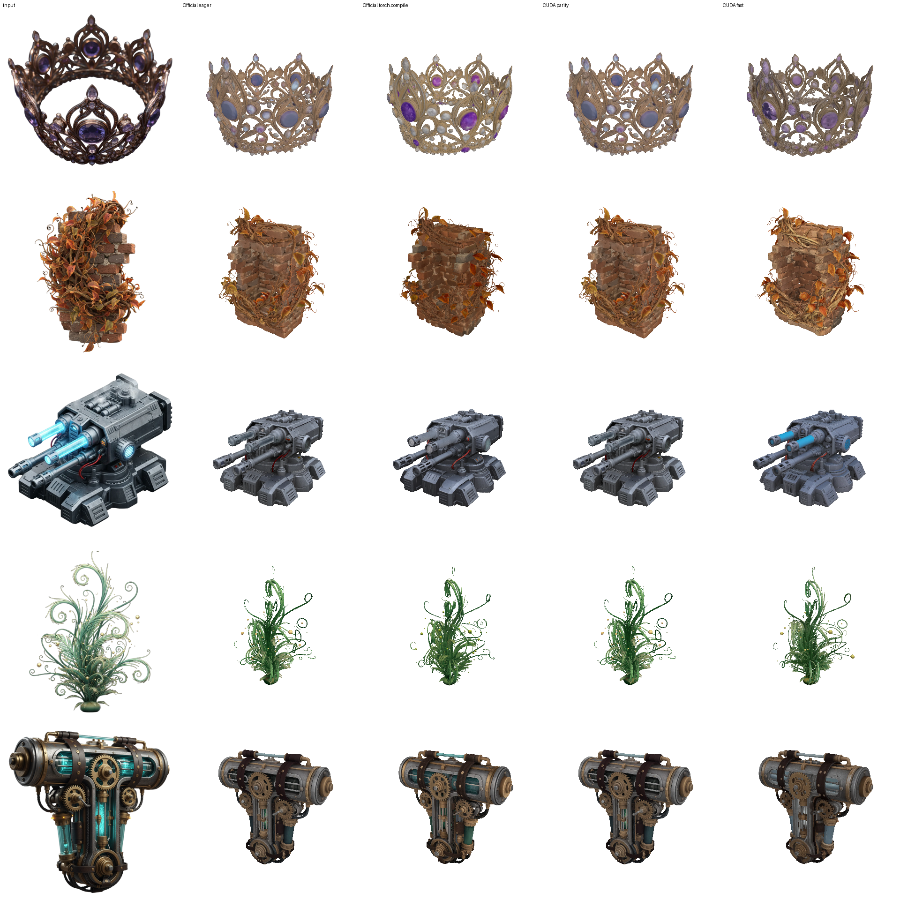
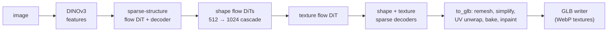
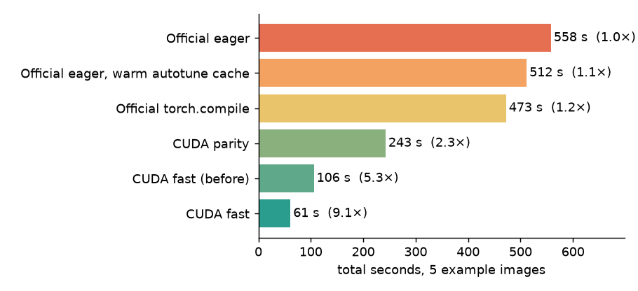

<h1 align="center">trellis2-cuda</h1>

<p align="center">
  <b>One image in, a textured 3D mesh out, 9.1× faster than the official PyTorch pipeline on an H200.</b><br>
  TRELLIS.2-4B rebuilt in CUDA C++ with no Python at runtime: a bitwise-identical parity build and a fast build.
</p>

<p align="center">
  
  <a href="https://huggingface.co/microsoft/TRELLIS.2-4B"></a>
  <a href="https://huggingface.co/kernels/suvadityamuk/trellis2-cuda"></a>
  <a href="https://huggingface.co/spaces/suvadityamuk/trellis2-cuda"></a>
  
</p>

<p align="center">
  
</p>

```bash
python scripts/infer.py image.png -o out.glb
```

You get `out.glb`: a remeshed, simplified, UV-unwrapped mesh with baked PBR textures, the same file the official
`example.py` writes with its `to_glb` settings (`1024_cascade`, 1M faces, 4096² textures). Each row above is one
input image, then the official eager, official torch.compile, CUDA parity and CUDA fast results, all rendered from the
exported files with the same camera.

## Why

[TRELLIS.2](https://github.com/microsoft/TRELLIS.2) turns one image into a textured 3D asset. Its official pipeline is
PyTorch plus a stack of CUDA extensions, and most of its time is not in the neural networks at all: 339 of 558 s
over the five example images is `to_glb` (remeshing, simplification, UV unwrapping, texture baking), much of it serial
CPU work. trellis2-cuda runs the whole request, from the image encoder to the glTF bytes, as one C++/CUDA program:

| H200, 5 example images, image to GLB | seconds (sum) | speed-up |
|---|---:|---:|
| official PyTorch, eager | 558.4 | 1.0× |
| official PyTorch, eager, warm autotune cache | 512.0 | 1.1× |
| official PyTorch, torch.compile | 472.7 | 1.2× |
| trellis2-cuda parity build (bitwise identical to eager) | 242.9 | 2.3× |
| **trellis2-cuda fast build** | **61.4** | **9.1×** |

Warm process, one warm-up, model loading excluded, all rows measured in one H200 job. Per-image tables, the first
session and the compute cost: [docs/benchmark.md](docs/benchmark.md).

Try it without building anything in the [Space](https://huggingface.co/spaces/suvadityamuk/trellis2-cuda): it runs
the same image through the official PyTorch code and the fast build on the same GPU and shows both times and both
GLBs.

<!-- SPACE_SCREENSHOT -->

## Install

You need Linux x86_64, an NVIDIA H200/H100 (sm_90) or RTX PRO 6000 / RTX 50-series (sm_120) GPU, CUDA 12.4 or newer
(12.8 for sm_120) with `nvcc`, cuDNN 9, CMake ≥ 3.24, Ninja, git and Python 3. The DINOv3 image encoder is gated:
accept its licence on [its Hub page](https://huggingface.co/facebook/dinov3-vitl16-pretrain-lvd1689m) first.

```bash
git clone https://github.com/suvadityamuk/trellis2-cuda && cd trellis2-cuda
pip install huggingface_hub pillow     # rembg onnxruntime too, to accept images without a transparent background
hf auth login                          # or export HF_TOKEN=...
```

## Usage

```bash
python scripts/infer.py image.png -o out.glb             # fast build
python scripts/infer.py image.png -o out.glb --parity    # bitwise identical to the official pipeline
python scripts/infer.py image.png -o out.glb --seed 7    # another sample of the same image
python scripts/infer.py image.png -o out.glb --profile   # per-stage and sub-stage times
```

The first call builds the binary for your GPU (`tools/build.sh` fetches the pinned third-party sources and compiles
`build/t2`; 10-20 minutes) and downloads the checkpoints (about 16 GB) into `~/.cache/trellis2-cuda/ckpts`, linked
under the names the loader expects. Later calls only run the binary. The input needs a foreground mask: a
transparent background is used as is; otherwise the script removes the background with rembg if it is installed.

The binary can also be built and called directly:

```bash
tools/build.sh build                                      # sm_90; for sm_120: T2_CMAKE_ARGS=-DT2_CUDA_ARCH=120 tools/build.sh build120
T2_CKPT=~/.cache/trellis2-cuda/ckpts ./build/t2 image.png out.glb [seed]            # parity build
T2_CKPT=~/.cache/trellis2-cuda/ckpts T2_FAST=1 ./build/t2 image.png out.glb         # fast build
T2_CKPT=~/.cache/trellis2-cuda/ckpts ./build/t2 --bench out.json out_dir img...     # timing as in tools/bench_ref.py
```

Switches, all environment variables:

| variable | default | what |
|---|---|---|
| `T2_FAST` | 0 | 1 = fast build |
| `T2_CKPT` | `/workspace/ckpts` (`scripts/infer.py`: `~/.cache/trellis2-cuda/ckpts`) | checkpoint directory |
| `T2_FLEXGEMM_CACHE` | `assets/flexgemm_autotune.json` | sparse-conv tile choices shared with the official side, for parity |
| `T2_PROF`, `T2_DITPROF`, `T2_DECPROF` | 0 | stage, per-op DiT and per-level decoder timing |
| `T2_DIT_FUSE`, `T2_DIT_GELU_EPI` | 1 | fast build: fused DiT kernels, GELU in the GEMM epilogue |
| `T2_TELEA_GPU` | 1 | fast build: GPU texture inpainting instead of the CPU TELEA |
| `T2_XA_SPLIT` | 1024 | fast build: chart size above which charts are split before xatlas |
| `T2_WEBP_ALPHA_Q` | 0 | fast build: WebP quality of the base-color alpha plane (the material is opaque) |

The pipeline is also a C library (`libt2.so`: `t2_load`, `t2_image_to_glb`, `t2_last_error`, see `apps/t2lib.cu`);
`space/t2.py` wraps it with ctypes.

**Two kernels on the Kernel Hub.** The GPU BVH and the wavefront TELEA inpaint are packaged for PyTorch as
[suvadityamuk/trellis2-cuda](https://huggingface.co/kernels/suvadityamuk/trellis2-cuda) (source in
`hub/trellis2-kernels/`, 17 builds for torch 2.10-2.15 and CUDA 12.6-13.4):

```python
from kernels import get_kernel  # pip install -U kernels

k = get_kernel("suvadityamuk/trellis2-cuda", version=1, trust_remote_code=True)
dist, face_id, bary = k.mesh_udf(vertices, faces, points)   # point-to-mesh distance, nearest face, barycentrics
filled = k.telea_inpaint(image, mask, radius=3)             # a GPU alternative to cv2.inpaint(..., INPAINT_TELEA)
```

## How it works



Every stage is C++/CUDA: DINOv3, the flow transformers and their samplers, the sparse-convolution decoders,
FlexGEMM's submanifold convolution, the `to_glb` post-processing (CuMesh, cuBVH, xatlas, nvdiffrast for the bake),
OpenCV's TELEA inpaint and the trimesh/PIL glTF writer. Third-party CUDA code (flash-attention, CuMesh, cuBVH,
xatlas, FlexGEMM, nvdiffrast, cudnn-frontend, cutlass, libwebp) is reused unmodified. The parts written by hand are
those where matching torch exactly needed control over operation order: elementwise ops and norms, the sparse-conv MMA
kernel, sampling, preprocessing, the RNG, TELEA and the GLB writer.

The full worklog (method, bugs, figures) is in [docs/blog.md](docs/blog.md).

## Optimizations: where the time went

The official pipeline spends 61% of its time in `to_glb`, after the networks have finished. Sums over the five
images, H200:

| stage | official eager | CUDA parity | CUDA fast |
|---|---:|---:|---:|
| pipeline (encoder, flow DiTs, decoders) | 176.5 s | 65.4 s | 43.4 s |
| `to_glb` (remesh, simplify, UV unwrap, bake) | 338.6 s | 149.4 s | 15.2 s |
| GLB export | 43.2 s | 28.2 s | 2.8 s |
| **total** | **558.4 s** | **242.9 s** | **61.4 s** |

The parity build is already 2.3× faster with the same arithmetic: most of that is in `to_glb`, where xatlas's thread
pool is sized to the container's CPU quota (bitwise-safe); the rest is the Python overhead removed from around the
same kernels, and no per-shape autotuning. The fast build then changes how the work is done, in two rounds.

First round (single image, T.png):

| change | effect |
|---|---|
| GPU linear BVH (Morton codes, radix sort, Karras tree) instead of cuBVH's CPU build | remesh BVH 7.1 s → 5 ms, remesh still bitwise |
| Split CuMesh charts above 1,024 faces before xatlas (its chart growth is quadratic and serial per mesh) | ComputeCharts 36 s → 1.3 s, about 1% more charts |
| GPU wavefront TELEA: every pixel at the same distance level filled in parallel, all 6 channels at once | inpaint 8.2 s → 0.15 s |
| FlashAttention-3 (Hopper, bf16, head dim 128) for all DiT attention | shape DiT 7.7 → 5.6 s, texture DiT 3.7 → 2.6 s |
| WebP method 0 | export 6.0 → 1.4 s |

Second round (sums over the five images, previous fast build → current):

| change | effect |
|---|---|
| Grouped parallel xatlas (`src/uv_atlas.cpp`): pieces dealt into 64 area-balanced groups, one atlas per group on its own thread with a shared texel scale, results shelf-packed | UV unwrap 32.6 → 11.2 s |
| Pooled device allocator for CuMesh (`third_party/shim/cm_alloc.h`) and device-side buffer fills; no arithmetic change, so the parity build uses it too | simplify 12.2 → 1.7 s, remesh 1.4 → 0.75 s |
| DiT kernels: fused LayerNorm + modulation, q/k RMSNorm + RoPE + packing, gated residual + LayerNorm; GELU in the cuBLASLt GEMM epilogue | pipeline 50.4 → 43.4 s |
| GPU texture packing; base-color WebP alpha plane at quality 0 | export 7.3 → 2.8 s, bake + textures 2.0 → 1.6 s |

Where the fast build's 61.4 s now goes (seconds):

| image features | sparse structure | shape DiT | texture DiT | decoders | remesh | simplify | UV unwrap | bake | textures | export |
|---:|---:|---:|---:|---:|---:|---:|---:|---:|---:|---:|
| 0.90 | 2.94 | 23.00 | 11.39 | 5.17 | 0.75 | 1.69 | 11.16 | 0.80 | 0.79 | 2.83 |

Tried and dropped, with the reason:

| idea | result |
|---|---|
| Batch the guidance passes (cond and uncond) into one forward | FlashAttention-3 and the GEMMs already run near 600 TFLOP/s at these token counts; the bound is under 1 s over the five images |
| Rewrite the sparse decoders | 72% of their time is the sparse-conv kernel itself |
| jemalloc / tcmalloc, group-count and thread-count sweeps for xatlas | no gain: xatlas is CPU-bound in ComputeCharts on the 23-vCPU quota |
| Smaller chart split (`T2_XA_SPLIT` 512 / 256 / 128) | up to 30% less xatlas time on one image for 1% more charts at 512, 9-30% more charts below; kept at 1024 |

<a id="results-h200-5-example-images-warm-process-1-warmup-seconds"></a>
## Benchmark

<p align="center">
  
</p>

One HF Jobs H200 session (1× H200, 23 vCPU), all builds in one job, warm process, one warm-up, model loading
excluded, image to written GLB, seconds:

| image | official eager | official torch.compile | CUDA parity | CUDA fast |
|---|---:|---:|---:|---:|
| 0a34 | 84.7 | 90.6 | 46.8 | **9.6** |
| 0e49 | 160.5 | 124.8 | 60.5 | **19.3** |
| 0f16 | 88.8 | 97.7 | 50.0 | **13.4** |
| 130c | 131.8 | 77.3 | 27.3 | **6.7** |
| T.png | 92.6 | 82.3 | 58.2 | **12.4** |
| **sum** | 558.4 | 472.7 | 242.9 (2.3×) | **61.4 (9.1×)** |

"Official eager" starts from an empty FlexGEMM autotune cache, as a fresh install does; its time on 0e49 and 130c
includes Triton autotuning. Against eager with a warm cache (512.0 s) the fast build is 8.3×. The official `to_glb`
time varies by tens of seconds between runs of the same image (xatlas). Warm-cache numbers, the previous fast build,
the first session and the stage plots: [docs/benchmark.md](docs/benchmark.md). Raw JSON: [`bench/`](bench).

## Quality

The fast build is not byte-identical to the official pipeline; it is held to the official pipeline's own spread, i.e.
how far official torch.compile is from official eager. `tools/compare_glb.py` measures the symmetric Chamfer
distance over the bounding-box diagonal and the base-color L1 (0-255) at matched surface points, against official
eager:

| image | eager vs eager (run to run) | torch.compile vs eager | CUDA fast vs eager |
|---|---|---|---|
| 0a34 | 1.0e-3 / 3.1 | 2.2e-3 / 18.5 | 2.1e-3 / 19.5 |
| 0e49 | 1.4e-3 / 7.1 | 4.0e-3 / 23.3 | 3.6e-3 / 26.4 |
| 0f16 | 1.4e-3 / 4.8 | 2.8e-3 / 23.7 | 2.7e-3 / 27.3 |
| 130c | 0.7e-3 / 3.6 | 4.4e-3 / 24.1 | 4.4e-3 / 25.4 |
| T.png | 1.3e-3 / 5.3 | 2.5e-3 / 27.5 | 2.6e-3 / 26.8 |

- **Geometry:** Chamfer at or below torch.compile's on three images, 1% above on 130c and 8% above on T.png.
- **Color:** inside torch.compile's range over the set (18.5-27.5), but above the same image's torch.compile number
  on 0e49 (+3.1) and 0f16 (+3.6). That comes from the fused DiT kernels (a different but equally valid sample), not
  from the atlas or WebP changes: with them off, those two images match the previous fast build.
- **Sampling:** the DiT's teacher-forced error matches the official pipeline's own error when its attention backend
  is switched from flash_attn to xformers.

<p align="center">
  
</p>

## Parity

The parity build exists to show that the port is exact before it is fast. From the input image to the final mesh
and attributes, and through the GLB writer (texture bake, TELEA inpaint, WebP, glTF bytes), it is bitwise identical
to the official PyTorch pipeline. The one exception is the vertex-normal buffer: CuMesh accumulates normals with
atomics, so the official code is nondeterministic there too.

FlexGEMM chooses sparse-conv tiles by timing them, so its choices (and the fp32 accumulation order) can differ
between machines. `assets/flexgemm_autotune.json` holds the H200 choices for the five example images; the CUDA build
reads it, and `tools/repro_parity.sh` points the official pipeline at the same file. On a fresh H200 container that
script passes all 15 checks (5 images × `pipe`, `glb`, `bake`). A new image or GPU needs one official run first, to
add its tiles to the cache.

```bash
tools/setup_ref.sh             # official PyTorch reference (parity checks and baselines only)
tools/repro_parity.sh build    # official dumps + bitwise checks on the 5 example images
```

## The Space

[suvadityamuk/trellis2-cuda](https://huggingface.co/spaces/suvadityamuk/trellis2-cuda) runs on ZeroGPU (a slice of
an RTX PRO 6000 Blackwell, sm_120). `libt2.so` there is the fast build compiled for sm_120 with FlashAttention-2 in
place of the Hopper-only FlashAttention-3, loaded with ctypes in a subprocess of the GPU worker: it links the CUDA 12
runtime and cuDNN, while the official side's torch is CUDA 13 and both cuDNN builds share one soname. The official
side is the `trellis2` package with the requirements of Microsoft's own
[TRELLIS.2 Space](https://huggingface.co/spaces/microsoft/TRELLIS.2), run eagerly. Build and assemble it with:

```bash
T2_CMAKE_ARGS=-DT2_CUDA_ARCH=120 tools/build.sh build120   # CUDA 12.8
tools/make_space.sh build120 <TRELLIS.2 checkout>
```

<!-- SPACE_NUMBERS -->

## Limits and what is untested

- **Tested hardware:** the benchmarks and the parity checks ran on one H200 (sm_90). The sm_120 build runs in the
  Space and was checked on a full RTX PRO 6000; nothing else has been run.
- **Parity is per machine:** bitwise identity holds on the tested H200 setup with the shared autotune cache. Other
  GPUs, drivers or library versions can pick other kernels.
- **Closeness misses:** T.png geometry 8% above torch.compile's distance, and color on 0e49 and 0f16, as above.
- **Licences of built binaries:** nvdiffrast and parts of cuBVH are under NVIDIA's non-commercial source code
  licence, so `build/t2`, `build/parity` and `libt2.so` are for non-commercial use. The Kernel Hub package does not
  use either.

## Development and reproduction

| path | what |
|---|---|
| `src/` | models (DINOv3, flow DiTs, sparse-structure, shape and texture decoders), GEMM / attention / sparse-conv ops, the `to_glb` port (`glb.cu`), OpenCV TELEA (`inpaint.cpp`), the glTF writer (`gltf.cpp`), grouped xatlas (`uv_atlas.cpp`) |
| `apps/` | `t2.cu` (the binary), `parity.cu` (per-stage bitwise checks against dumps from `tools/ref_dump.py`), `t2lib.cu` (the C library) |
| `scripts/` | `infer.py`: one-command inference (checkpoints, build, run) |
| `tools/` | `build.sh` (fetch pinned sources, build), offline Python: reference dumps, official timing, GLB comparison, plots and renders, build and Space scripts |
| `bench/` | raw timings and comparison outputs |
| `assets/` | `flexgemm_autotune.json`, the sparse-conv tile choices shared by both sides |
| `hub/trellis2-kernels/` | the Kernel Hub package (`mesh_udf`, `telea_inpaint`), Apache-2.0 |
| `space/` | the Gradio Space |
| `docs/` | worklog, benchmark details, plots, renders |

## Related

Part of [TRELLIS.2 everywhere](https://huggingface.co/collections/hugging-3d/trellis2-everywhere-6b062cf7d5ae3eca49def35b), built on Microsoft's [TRELLIS.2](https://huggingface.co/microsoft/TRELLIS.2-4B) ([paper](https://huggingface.co/papers/2512.14692)).

| | Hugging Face | GitHub |
|---|---|---|
| Guide | [The Definitive Fine-Tuning Guide for 3D Generation Models](https://huggingface.co/blog/3d-lora-finetuning) | |
| Fine-tuning (LoRA) | [footwear LoRA](https://huggingface.co/suvadityamuk/trellis-2-finetune-gso) · [trainer Space](https://huggingface.co/spaces/hugging-3d/3d-model-lora-trainer) · [subset builder](https://huggingface.co/spaces/hugging-3d/data-finetuning-subset-builder) | [trellis2-finetuning](https://github.com/suvadityamuk/trellis2-finetuning) |
| Data | [GSO footwear](https://huggingface.co/datasets/suvadityamuk/gso-footwear-trellis2-latents) · [GSO](https://huggingface.co/datasets/hugging-3d/gso-trellis2-latents) · [Smithsonian](https://huggingface.co/datasets/hugging-3d/smithsonian-trellis2-latents) · [NASA](https://huggingface.co/datasets/hugging-3d/nasa-trellis2-latents) latents | |
| Diffusers port | [TRELLIS.2-4B-diffusers-3d](https://huggingface.co/suvadityamuk/TRELLIS.2-4B-diffusers-3d) | [diffusers-3d](https://github.com/suvadityamuk/diffusers-3d) |
| NVIDIA (CUDA C++) | [kernels](https://huggingface.co/kernels/suvadityamuk/trellis2-cuda) · [Space](https://huggingface.co/spaces/suvadityamuk/trellis2-cuda) | [trellis2-cuda](https://github.com/suvadityamuk/trellis2-cuda) |
| Apple Silicon (Metal) | [kernels](https://huggingface.co/kernels/suvadityamuk/trellis2-metal) | [trellis2-metal](https://github.com/suvadityamuk/trellis2-metal) |
| AMD (ROCm/HIP) | [kernels](https://huggingface.co/kernels/suvadityamuk/trellis2-rocm) | [trellis2-rocm](https://github.com/suvadityamuk/trellis2-rocm) |

## Credits

- [TRELLIS.2](https://github.com/microsoft/TRELLIS.2) by Microsoft (MIT): the pipeline, model architectures and
  post-processing reproduced here. Example images are from its repository.
- Reused CUDA code, fetched by `tools/build.sh` and not redistributed: flash-attention 2.7.3, CuMesh, cuBVH, xatlas,
  FlexGEMM, nvdiffrast 0.4.0, cudnn-frontend, cutlass, libwebp 1.4.0. `src/inpaint.cpp` ports OpenCV's TELEA
  (Apache-2.0). See [NOTICE](NOTICE).
- Packaging for the Kernel Hub with [kernel-builder](https://github.com/huggingface/kernels).
- README layout after [idol-mlx](https://github.com/cfahlgren1/idol-mlx).

Licence: Apache-2.0 ([LICENSE](LICENSE)); built binaries are additionally subject to the NVIDIA licences above.
