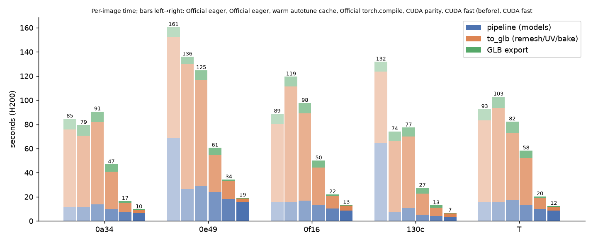
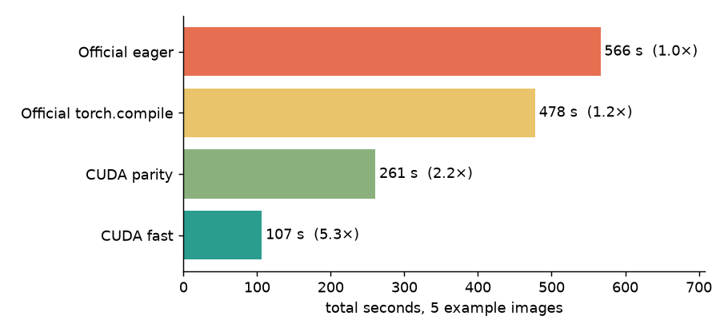
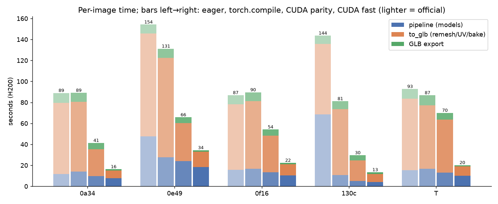

# Benchmark details

Everything here is measured on HF Jobs `h200` (1× H200, 23 vCPU) over the five example images (`0a34`, `0e49`, `0f16`,
`130c`, `T.png`) in a warm process with one warm-up, from the input image to the written GLB, model loading excluded.
Raw numbers are in [`bench/`](../bench); the plots are drawn by `tools/plot_bench.py`. The summary is in the
[README](../README.md#benchmark).

## Second session (current fast build)

All six columns were measured in one H200 job.

| Image | Official eager | Official eager, warm autotune | Official torch.compile | CUDA parity | CUDA fast (before) | CUDA fast |
|---|---|---|---|---|---|---|
| 0a34 | 84.7 | 79.4 | 90.6 | 46.8 | 16.5 | **9.6** |
| 0e49 | 160.5 | 136.0 | 124.8 | 60.5 | 34.3 | **19.3** |
| 0f16 | 88.8 | 119.5 | 97.7 | 50.0 | 22.0 | **13.4** |
| 130c | 131.8 | 74.2 | 77.3 | 27.3 | 13.0 | **6.7** |
| T.png | 92.6 | 102.9 | 82.3 | 58.2 | 20.3 | **12.4** |
| **Sum** | 558.4 | 512.0 | 472.7 | 242.9 (2.3×) | 106.1 (5.3×) | **61.4 (9.1×)** |
| pipeline / `to_glb` / export | 176.5 / 338.6 / 43.2 | 76.4 / 395.1 / 40.6 | 87.3 / 343.2 / 42.2 | 65.4 / 149.4 / 28.2 | 50.4 / 48.4 / 7.3 | 43.4 / 15.2 / 2.8 |

"Official eager" starts from an empty FlexGEMM autotune cache; its `pipeline` time includes Triton autotuning on
first-seen sparse-conv shapes (0e49, 130c). "Warm autotune" is the same run repeated with the cache it left behind,
and torch.compile also ran with that cache. Against warm eager the fast build is 8.3×. The official `to_glb` time
varies by tens of seconds between runs of the same image (xatlas), which is why warm eager is slower than cold eager
on 0f16 and T.png. "CUDA fast (before)" is the previous fast build (git `4b7c7cd`) built and run in the same job.
Raw numbers: `bench/{eager_v2,eager_warm_v2,compile_v2,cuda_v2,fast_old,fast_v2}.json`.

Per-stage sums over the 5 images for the current fast build (`stages` in `bench/fast_v2.json`):

| cond | sparse_structure | shape_slat | tex_slat | decode | remesh | simplify | uv_unwrap | bake | textures | export |
|---|---|---|---|---|---|---|---|---|---|---|
| 0.90 | 2.94 | 23.00 | 11.39 | 5.17 | 0.75 | 1.69 | 11.16 | 0.80 | 0.79 | 2.83 |

## First session

| Image | Official eager | Official torch.compile | CUDA parity | CUDA fast |
|---|---|---|---|---|
| 0a34 | 89.0 | 89.1 | 41.3 | **16.3** |
| 0e49 | 154.2 | 131.2 | 65.8 | **34.4** |
| 0f16 | 86.9 | 89.6 | 54.2 | **22.4** |
| 130c | 143.6 | 81.1 | 29.6 | **13.4** |
| T.png | 92.8 | 86.8 | 70.0 | **20.2** |
| **Sum** | 566.5 | 477.8 | 260.9 (2.2×) | **106.6 (5.3×)** |

Speedups are relative to eager.

Most of the official time is in `to_glb`: a serial CPU cuBVH build, quadratic xatlas chart growth, and
single-threaded TELEA. The large eager `pipeline` times on 0e49 and 130c are FlexGEMM's Triton autotuning on
first-seen sparse-conv shapes. The torch.compile run came afterwards and reused that saved cache
(`~/.flex_gemm/autotune_cache.json`). The CUDA build has no per-shape tuning step.

## Closeness, full tables

`tools/compare_glb.py`: symmetric Chamfer distance over the bounding-box diagonal, and base-color L1 (0-255) at
matched surface samples, each against an official eager GLB.

First session, against cold-cache eager:

| Image | compile vs eager (Chamfer / color) | parity vs eager | fast vs eager |
|---|---|---|---|
| 0a34 | 2.4e-3 / 16.2 | 1.3e-3 / 3.3 | 2.4e-3 / 20.5 |
| 0e49 | 4.0e-3 / 23.3 | 1.7e-3 / 7.9 | 3.8e-3 / 23.6 |
| 0f16 | 2.9e-3 / 26.9 | 1.7e-3 / 5.6 | 3.0e-3 / 24.1 |
| 130c | 4.5e-3 / 25.8 | 0.9e-3 / 4.0 | 4.6e-3 / 26.6 |
| T.png | 3.0e-3 / 25.2 | 1.6e-3 / 6.1 | 2.8e-3 / 28.7 |

(Parity vs eager is nonzero only because CuMesh simplify is nondeterministic run to run.)

Second session, against the warm-cache eager GLBs (`bench/compare_v2.txt`). "eager vs eager" is the cold-cache eager
run against the warm-cache one, i.e. the official pipeline's own run-to-run spread:

| Image | eager vs eager | compile vs eager | parity vs eager | fast (before) vs eager | fast vs eager |
|---|---|---|---|---|---|
| 0a34 | 1.0e-3 / 3.1 | 2.2e-3 / 18.5 | 1.0e-3 / 3.1 | 2.2e-3 / 20.5 | 2.1e-3 / 19.5 |
| 0e49 | 1.4e-3 / 7.1 | 4.0e-3 / 23.3 | 1.4e-3 / 7.1 | 3.6e-3 / 23.6 | 3.6e-3 / 26.4 |
| 0f16 | 1.4e-3 / 4.8 | 2.8e-3 / 23.7 | 1.4e-3 / 4.8 | 2.7e-3 / 24.2 | 2.7e-3 / 27.3 |
| 130c | 0.7e-3 / 3.6 | 4.4e-3 / 24.1 | 0.7e-3 / 3.6 | 4.5e-3 / 26.6 | 4.4e-3 / 25.4 |
| T.png | 1.3e-3 / 5.3 | 2.5e-3 / 27.5 | 1.3e-3 / 5.3 | 2.5e-3 / 28.7 | 2.6e-3 / 26.8 |

Chamfer is at or below compile-vs-eager on three images, 1% above it on 130c and 8% above it on T.png. Color L1 is
inside the compile-vs-eager range over the set (18.5-27.5) but above the same image's compile number on 0e49 (+3.1)
and 0f16 (+3.6), and below it on T.png. The color differences come from the DiT changes (a different but equally
valid sample), not from the atlas or WebP changes: with `T2_DIT_FUSE=0 T2_DIT_GELU_EPI=0` the new build gives 23.6
and 24.2 on those two images, the same as the previous fast build, with or without the grouped atlas
(`bench/compare_ab_v2.txt`). Teacher-forced sampling error (`parity sample`, mean abs / max abs for the
sparse-structure stage): 0e49 0.0190 / 1.64 before, 0.0179 / 0.92 now; 0a34 0.0166 / 0.88 before, 0.0170 / 1.50 now.

## Compute cost

HF Jobs compute, from job running time × listed price:

| Job | Flavor | Price | Running | Cost |
|---|---|---|---|---|
| `6ac54e95…` (all builds, parity runs, benchmarks) | h200 (1× H200, 23 vCPU) | $5.00/h | 8.4 h | ~$42 |
| `6ac55477…` (CPU box started while the H200 was queued 43 min) | cpu-performance | $1.90/h | 8.7 h | ~$17 |
| `6ac5e12c…` + `6ac5e099…` (fresh-container parity reproduction) | h200 | $5.00/h | 58 min | ~$5 |
| **Total, first session** | | | | **~$64** |

Second session (end-to-end optimizations): `6b04ae01…` h200, 3.9 h, ~$19; `6b04c7df…` rtx-pro-6000 ($2.75/h,
sm_120 TELEA reproduction and fix check), 0.5 h, ~$1.4.

The benchmarks themselves are a small part of this. One full 4-way pass over the 5 images is about 24 GPU-minutes
(~$2). Most of the cost is development time on an idle-billing `sleep infinity` job.
